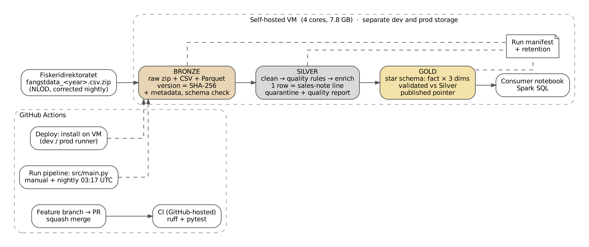

# DAT535 Group Project – Medallion Data Pipeline

A batch data pipeline in **Apache Spark (PySpark)** that turns Norwegian fisheries landing
data into trusted, analysis-ready tables, following the Medallion architecture
(Bronze → Silver → Gold). It runs in separate **dev** and **prod** environments and is
tested, deployed and scheduled with **GitHub Actions**.

> **Question:** How do landed fish quantity and species composition vary by Norwegian
> region and month?

**Data:** [Fiskeridirektoratet – catch data linked with vessel data](https://www.fiskeridir.no/statistikk-tall-og-analyse/data-og-statistikk-om-yrkesfiske/apne-data-fangstdata-seddel-koblet-med-fartoydata)
(Norwegian Licence for Open Government Data, NLOD). One zipped, semicolon-separated CSV per
catch year (about 1.1 million rows and 133 columns per year). The last three catch years are
corrected almost every night, so the pipeline must keep the data correct as the source
changes, without counting the same landings twice.

> **Report:** [Project report](report.md): design choices, results, performance
> analysis and limitations.



## Results at a glance

| | Value |
|---|---|
| Catch year 2023 (dev) | 1,079,929 rows Bronze → Silver, 0 rejected, 188,580 rows flagged, 0 unreadable values |
| Catch years 2023–2025 (prod) | 3,041,954 rows → 17,083 Gold facts, validated and published |
| Gold (2023) | 5,496 facts (month × region × species); peak in March, low in December |
| Performance (VM) | Optimized deduplication: −19.2% run time, −80.5% shuffle ([details](docs/performance.md)) |
| Tests | 119 pytest tests, run by CI on every pull request |

## How it works

| Layer | What it does | Docs |
|---|---|---|
| **Bronze** | Downloads each catch year, keeps every version unchanged (identified by SHA-256), adds metadata columns, checks the schema against the 133 expected columns. `--force` re-ingests a year. | [Bronze ingestion](docs/bronze-ingestion.md) |
| **Silver** | Cleans and types the data (one row = one sales-note line, 5-field key), applies the quality rules in `config/base.yaml` (reject or flag), writes rejected rows to quarantine and a before/after quality report per run. | [Model](docs/silver-model.md), [cleaning](docs/silver-cleaning.md), [enrichment](docs/silver-enrichment.md) |
| **Gold** | Builds a star schema (one fact table, three dimensions), validates it against Silver (exact totals, unique grain, no orphan rows, species shares) and publishes it only if every check passes. | [Gold model](docs/gold-model.md) |
| **Consumer** | Reads only the published Gold and answers the question in Spark SQL. | [`03_gold_consumer.ipynb`](notebooks/03_gold_consumer.ipynb) |

Every run has a run ID and writes a manifest with the result of each layer. If a layer
fails, the later layers are skipped and the run exits with code 1. When a source file is
corrected, Silver uses the newest Bronze version; after a full, successful run, old versions
are deleted (retention). Design decisions are recorded in [design.md](docs/design.md).

## Repository structure

```
src/
  bronze/        download, schema check, metadata, manifest, ingestion
  silver/        model, cleaning, quality rules, quarantine, quality report, enrichment
  gold/          star schema build, validation, publishing
  common/        config loader, Spark session, shared data classes, retention
  main.py        pipeline entry point
tests/           pytest tests per layer; tests/data/ holds a small sample file
config/          base.yaml + dev / prod / test overrides
notebooks/       01 source exploration, 02 Bronze profiling, 03 Gold consumer (Spark SQL)
scripts/         performance benchmark and Spark event-log summary
docs/            design, layer documentation, performance, evidence (JSON)
.github/workflows/
  ci.yml         lint + tests on every pull request (GitHub-hosted runner)
  deploy.yml     install the code on the VM (dev or prod runner)
  run.yml        run Bronze → Silver → Gold (manual, and nightly on prod)
```

## Getting started

### Requirements

- Python **3.11** (PySpark 3.5 does not support Python 3.13)
- Java **8** or **17** (CI and the VM use Java 8; Spark 3.5 supports both)
- About 3 GB of free disk space per catch year

### Setup

```bash
git clone https://github.com/ennasa/dat535-groupproject.git
cd dat535-groupproject
python3.11 -m venv .venv
source .venv/bin/activate          # Windows: .venv\Scripts\activate
pip install -r requirements.txt
```

### Run the tests

```bash
ruff check .
PIPELINE_ENV=test pytest
```

### Run the pipeline

```bash
PIPELINE_ENV=dev python src/main.py                            # all layers
PIPELINE_ENV=dev python src/main.py --layers bronze            # one layer
PIPELINE_ENV=dev python src/main.py --layers bronze --force    # re-ingest an unchanged file
```

The first run downloads catch year 2023 (about 55 MB, 1.2 GB unzipped). Output goes to
`data/dev/` (not committed):

```
data/dev/
  bronze/fiskeridir_catch/period=<year>/source_version=<sha256>/
  silver/catch_document_line/period=<year>/...
  gold/fisheries_seasonality/...     + _published.json (the published version)
  quarantine/...                      rejected rows per run
  reports/quality/<run_id>.json       before/after quality report
  manifests/<run_id>.json             what each run did
```

Then open `notebooks/03_gold_consumer.ipynb` to see the results.

## Configuration

`PIPELINE_ENV` (`dev`, `prod` or `test`, default `dev`) selects which file is merged on top
of `config/base.yaml`. `PIPELINE_STORAGE_ROOT` overrides the storage folder (used on the VM).

| File | Purpose |
|---|---|
| `base.yaml` | Shared defaults: storage layout, source, Spark settings, quality rules and thresholds, retention, logging |
| `dev.yaml` | Development: catch year 2023, keep 1 Bronze version, debug logging |
| `prod.yaml` | Production: catch years 2023–2025, VM storage path, keep 2 Bronze versions |
| `test.yaml` | Tests and CI: minimal local Spark, sample data only |

No secrets are needed. A test fails if a config key looks like a credential.

## Environments and automation

| | dev | prod |
|---|---|---|
| Runs on | self-hosted runner `dev` on the VM | self-hosted runner `prod` on the VM |
| Storage | `~/dat535/dev` | `~/dat535/prod` |
| Catch years | 2023 | 2023–2025 |
| Deploy | Actions → Deploy → Run workflow | same |
| Pipeline run | manual | manual and nightly at 03:17 UTC |

Both environments share one VM (4 cores, 7.8 GB RAM); runs are queued one at a time.

## Development workflow

1. Pick an issue from the project board.
2. Create a feature branch from `main` and open a pull request with `Closes #<issue>`.
3. CI must pass; the other team member reviews when possible.
4. Squash merge, so `main` has one commit per change.

## Known limitations

- Deploys are started manually; automatic deploy on merge or release tag is not enabled.
- Spark runs in local mode on one VM with the default 1 GB driver memory, which causes spill.
- Catch year 2023 has no rejected rows, so the reject and quarantine path is tested with
  sample data, not real data.
- Kelp is recorded as a landing in the source and is included in the Gold totals.
- There is no alert when a run fails or takes unusually long.

## Team

| Member | Main responsibility |
|---|---|
| Ennasa | Repository, CI/CD and environments, design document; Silver quality rules, quarantine and quality report; Gold validation and publishing; retention; consumer notebook; report |
| Robot flame | Dataset and project definition; first implementation of Bronze, Silver and Gold (#48); profiling; performance benchmark |

The AI assistant Claude was used during the project, including for generating parts of the
code and documentation; all code was reviewed and tested by the team.
