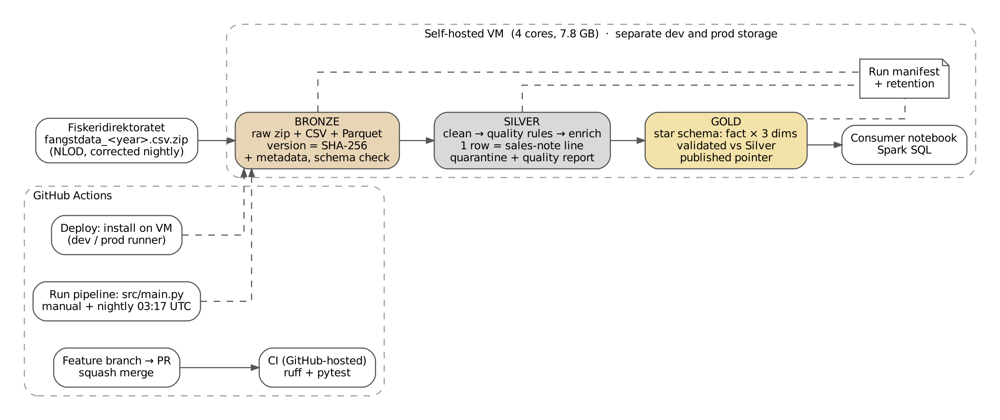

# Norwegian Fisheries Landings: A Medallion Data Pipeline with PySpark

**DAT535 Data Engineering – Group project report**
Group members: ennasa, robotflame · [github.com/ennasa/dat535-groupproject](https://github.com/ennasa/dat535-groupproject) · Date: 11 November 2026

## 1. Introduction

Norway is one of the world's largest seafood exporters, and every landing of fish is recorded on a sales note by the Norwegian Directorate of Fisheries (Fiskeridirektoratet). This project uses those records to answer one question:


> **Question:** How do landed fish quantity and species composition vary by Norwegian region and month?

The data is published as open data under the Norwegian Licence for Open Government Data (NLOD): one zipped, semicolon-separated CSV file per catch year, with about 1.1 million lines and 133 columns per year. The files for the last three catch years are corrected almost every night, and catch values are only published 12 months after landing. This meant we needed a pipeline that keeps the data correct as the source changes, without counting the same landings twice.

We built a Medallion pipeline in PySpark. Bronze preserves every version of the raw files, Silver turns them into a validated and documented dataset, and Gold serves a small star schema to an analyst, who answers the question in Spark SQL. The pipeline runs in separate development and production environments on a self-hosted VM, with automated tests, deployment and a nightly schedule through GitHub Actions.

## 2. Architecture



*Figure 1: Source → Bronze → Silver → Gold → consumer notebook, with GitHub Actions (CI on GitHub-hosted runners; deploy and scheduled run on the VM's dev and prod runners).*

The pipeline uses the Medallion architecture (Figure 1). Bronze downloads the yearly files and keeps every version unchanged, identified by its SHA-256 checksum. Silver cleans the data, applies our quality rules and writes rejected rows to quarantine. Gold builds a small star schema for the analyst, checks it against Silver, and only publishes it if all checks pass. The notebook reads the published Gold with Spark SQL.

We chose this setup so that each layer can be rerun and checked on its own, and so that data is never overwritten: each version gets its own folder. A run ID follows the data through all layers, so every result can be traced back to its source file. Settings that differ between environments are in config files, selected by `PIPELINE_ENV`.

Dev and prod run on the same VM, with separate runners, configs and folders, so we test changes on dev before prod. CI runs on GitHub’s own machines for every pull request. The downside is that dev and prod share the VM’s 4 cores and 7.8 GB of memory, and Spark runs in local mode instead of on a cluster.

**Table 1: Technical choices**

| Component | Choice |
|---|---|
| Processing | PySpark 3.5.0, `local[*]`, 4 cores, 7.8 GB RAM |
| Runtime | Python 3.11, Java 8, pinned in `requirements.txt` |
| Testing | 119 pytest tests, run by CI on every pull request |

## 3. Bronze: ingest and preserve

Fiskeridirektoratet rewrites the files for the last three catch years almost every night. We therefore decided to keep every version of the raw file unchanged and identify it by its SHA-256 checksum. This way we can always trace a result back to the exact file it came from, and rerun later layers on the same data.

For each catch year, Bronze downloads the zip file and computes its checksum. If a file with the same checksum is already stored, the year is skipped. Otherwise the file is unzipped, every row is checked to have the expected number of fields, and a Parquet copy is written with five metadata columns: `_source_name`, `_source_file`, `_source_period`, `_ingested_at` and `_run_id`. The row counts in the CSV and the Parquet copy must match. Only then is the finished folder moved into place, so a crash never leaves a half-written version behind. Table 2 shows the result for 2023.

**Table 2: Bronze ingestion of catch year 2023**

| Measure | Value |
|---|---|
| Archive (zip) | 54,943,248 bytes |
| Extracted CSV | 1,209,038,213 bytes |
| Source columns | 133 (schema unchanged vs. expected) |
| Rows CSV → Parquet | 1,079,929 → 1,079,929 |
| Rerun with unchanged file | skipped (same SHA-256) |
| `--force` rerun | snapshot replaced, 1,079,929 rows |

Each file's columns are compared with the 133 columns we expect. If a column is added, missing or changed, the new version is still stored, but Bronze reports the run as failed, so Silver and Gold do not use data with an unexpected structure. Every run also writes a manifest: a JSON file with the run ID, the files it downloaded and the result of each layer. The `--force` option makes Bronze ingest a file again even if it is already stored, for example if a stored version is damaged.

A limitation is that every version keeps the zip, the 1.2 GB CSV and the Parquet copy, so storage grows quickly when files change every night. This is why we added retention (section 6).

## 4. Silver: trusted, reusable data

### 4.1 Understanding the source

Before designing Silver, we profiled the full 2023 file (notebook `02_profile_bronze.ipynb`). One row is one line on a sales note, that is one species and product on one landing document, not one landing or one fish. The five fields catch year, sales organisation, document type, document number and line number were filled in for all 1,079,929 rows and never repeated, so together they work as a key. There were no exact duplicate rows. Profiling also showed what we later handle with rules: 17,721 rows without landing county, 150 without an FAO species code, one without round weight and 169,439 with a round weight of zero.

### 4.2 Model and cleaning

The Silver model keeps 74 of the 133 source columns, with English `snake_case` names. Codes are kept as text so leading zeros are not lost, and weights and values are stored as exact decimals (`decimal(24,6)`). We use round weight as the main quantity, because it is the live-weight equivalent and can be compared across species and product types. The model was proposed after profiling and approved by both of us before Silver was used.

Cleaning parses Norwegian dates and decimal commas, trims text and turns empty values into null. A missing value never becomes 0, because "missing" and "zero" mean different things in this data. Exact duplicate rows are removed. Rows that share a key but differ in other columns are not resolved in cleaning; they are caught by the quality rules instead.

### 4.3 Quality rules

The quality rules are defined in the config file (`quality.rules`), not in the code, so they are easy to read, review and change. Each rule has a check (`not_null`, `range`, `in_set`, `regex` or `unique`) and an action. A reject rule sends the row to quarantine. A flag rule keeps the row but adds the rule name to a `_quality_flags` column. We only reject rows that cannot be used at all, and flag real values that we want to keep but count, based on the profiling results.

**Table 3: Quality rules and results, catch year 2023**

| Rule | Check | Action | Rows (2023) | Reason |
|---|---|---|---:|---|
| `key_not_null` | not_null, 5 key columns | reject | 0 | 	A row without a key cannot be identified |
| `key_unique` | unique, 5 key columns | reject | 0 | Conflicting versions of the same line must not be counted twice |
| `landing_date_not_null` | not_null | reject | 0 | Gold needs the landing month |
| `round_weight_not_negative` | range ≥ 0 | reject | 0 |    A negative weight can only be an error |
| `product_weight_not_negative` | range ≥ 0 | reject | 0 | Same as above |
| `round_weight_missing` | not_null | flag | 1 | Real but rare; kept as null |
| `round_weight_zero` | range > 0 | flag | 169,439 | Zero is a real recorded value, not missing |
| `landing_county_missing` | not_null | flag | 17,721 | Mostly landings outside Norway |
| `species_fao_missing` | not_null | flag | 150 | Species is still known from the national code |
| `catch_value_missing` | not_null | flag | 26,434 | Values are published 12 months after landing |

All rules are checked in one pass over the data. Each rule first becomes a true/false column, and one `agg()` then counts all of them at once, instead of reading 1 million rows once per rule:

```python
# one True/False column per rule
marked = df
for i, name in enumerate(names):
    marked = marked.withColumn(f"_rule_{i}", _breaks(name, rules[name]))

# count all rules in one pass
counts = marked.agg(
    *[F.sum(F.col(f"_rule_{i}").cast("long")).alias(f"_rule_{i}") for i in range(len(names))]
).first()
```

### 4.4 Before/after quality evidence

Every Silver run writes a quality report with row counts, the result of each rule and missing values per column before and after processing. Table 4 and Table 5 come from the 2023 dev run.

**Table 4: Quality report, catch year 2023 (dev)**

| Rows | Value |
|---|---:|
| Bronze | 1,079,929 |
| After cleaning | 1,079,929 |
| Duplicates removed | 0 |
| Rejected (quarantine) | 0 |
| Accepted | 1,079,929 |
| Accepted with ≥1 flag | 188,580 |
| Quarantine rows = rejected | yes (0 = 0) |

**Table 5: Missing values before and after, catch year 2023**

| Column | Missing in Bronze | Invalid (unreadable) | Missing in Silver |
|---|---:|---:|---:|
| `document_number`, `line_number`, `landing_date` | 0 | 0 | 0 |
| `species_code`, `product_weight_kg` | 0 | 0 | 0 |
| `landing_county_code` | 17,721 | 0 | 17,721 |
| `species_fao_code` | 150 | 0 | 150 |
| `round_weight_kg` | 1 | 0 | 1 |
| `catch_value_nok` | 26,434 | 0 | 26,434 |

The report shows that cleaning neither lost nor invented data. Every date and number could be read (0 invalid values), and every value that is missing in Silver was already missing in the source. Missing values stay null instead of becoming 0. 188,580 rows (17.5%) have at least one flag, which is fewer than the sum of the flag counts because some rows have more than one flag. The 26,434 rows without catch value are probably a mix of late publication and prices that are withheld by the source.

In prod we ran Silver on the catch years 2023–2025: 3,041,954 rows in and out, with 0 rejected rows. Gold for prod has 17,083 fact rows for the three years.

Rejected rows are not deleted but written to a quarantine folder for each run, together with the names of the rules they broke and a summary file. The quarantine is written before Silver checks whether too many rows were rejected, so a failed run still keeps the rows that caused it. Because 2023 has no rejected rows, this part is proven by our tests, not by the real data.

### 4.5 Performance

We measured Silver on the same 2023 data with two versions of the duplicate handling: the original version, which always removes duplicates over all columns, and an optimized version, which first checks only the key for duplicates and repartitions once by key. The numbers come from Spark's event logs. The first measurements were made locally (WSL), and we repeated both versions on the VM with the quality rules included.

**Table 6: Silver performance, baseline vs. optimized (2023, 1,079,929 rows, one run each)**

| Measure | Baseline | Optimized | Change |
|---|---:|---:|---:|
| Wall time, local | 299.4 s | 197.8 s | −33.9% |
| Wall time, VM | 123.6 s | 99.8 s | −19.2% |
| Shuffle read = write, VM | 1,546 MB | 302 MB | −80.5% |
| Memory spill, VM | 6,333 MB | 2,701 MB | −57.4% |
| Disk spill, VM | 1,618 MB | 633 MB | −60.9% |
| Rows out | 1,079,929 | 1,079,929 | same |

The main effect is less shuffling. In the baseline, the two largest shuffle stages each wrote 474.5 MB; these come from the full-row duplicate removal and are gone in the optimized version. Both versions give exactly the same output. A first optimization attempt was slower (441.1 s locally) and was rejected, which shows why we measured instead of assuming. The gain on the VM (19%) is smaller than locally (34%), because the VM runs also include the quality rules and the quality report, which cost the same in both versions.

The VM runs still spill to disk, mainly because Spark only gets 1 GB of driver memory by default in local mode. One stage in the optimized run is also very uneven: one task took 38.6 s while the median task took 0.17 s. More driver memory and a better spread of that work are the next things we would try.

## 5. Gold: serving the analyst

Silver is reusable, line-level data. Gold is built for one question: how landed quantity and species composition vary by region and month. It is a small star schema with one fact table and three dimension tables, aggregated to one row per month, landing region and species.

**Table 7: Gold tables (2023)**

| Table | Grain | Rows |
|---|---|---:|
| `fact_monthly_species_region` | month × landing region × species | 5,496 |
| `dim_month` | landing year-month | 22 |
| `dim_landing_region` | country/county | 22 |
| `dim_species` | species classification | 158 |

Before Gold is published, it is checked against Silver (`src/gold/validate.py`). The number of lines, missing weights and the totals of round weight, product weight and catch value must match exactly. There must be exactly one row per month, region and species, every fact row must point to existing dimension rows, the species totals in each region and month must add up to the region total, and each species share must match its totals. Only if all checks pass is the pointer file `_published.json` updated. If a check fails, the previous version stays published.

The consumer notebook reads only the published Gold and answers the question in Spark SQL. We used the DataFrame API for the pipeline, where the code needs to be tested and reused, and SQL for the analysis, where readable queries matter more. The query below ranks the species in each month with a window function:

```sql
SELECT month_id, species_name, round_weight_kg,
       round_weight_kg / SUM(round_weight_kg) OVER (PARTITION BY month_id) AS share,
       RANK() OVER (PARTITION BY month_id ORDER BY round_weight_kg DESC) AS rank
FROM monthly
```

**Table 8: Landed round weight by month, Norwegian landings 2023 (tonnes)**

| Jan | Feb | Mar | Apr | May | Jun | Jul | Aug | Sep | Oct | Nov | Dec |
|---:|---:|---:|---:|---:|---:|---:|---:|---:|---:|---:|---:|
| 232,514 | 226,964 | **377,637** | 231,849 | 148,521 | 183,910 | 108,794 | 203,165 | 185,573 | 282,289 | 241,041 | **69,887** |

Total: 2,492,144 tonnes from 1,063,868 source lines.

**Table 9: Top counties by landed round weight, 2023 (tonnes)**

| County | Round weight | Source lines |
|---|---:|---:|
| Troms og Finnmark | 607,964 | 427,794 |
| Rogaland | 573,914 | 39,064 |
| Møre og Romsdal | 507,485 | 82,568 |
| Nordland | 338,685 | 306,307 |
| Vestland | 283,055 | 47,745 |
| Unknown / not supplied | 30,065 | 3,106 |

Landings peak in March, mainly blue whiting and cod, with a second high period in October and November, and are lowest in December. The species mix changes through the year: herring dominates in January and February, blue whiting from March to May, the summer months are more mixed, mackerel dominates in September and October, and herring returns in November. Troms og Finnmark, Rogaland and Møre og Romsdal land the most. The number of lines shows two different patterns: Rogaland has few but very large pelagic landings, while Nordland has many small coastal landings.

One limitation is that kelp (stortare) is counted as a landing in the source and makes up 173,104 tonnes. We only noticed this after building Gold, so the totals in this report include it. Since the question is about fish, a next step would be to filter out non-fish species using the species main group.

## 6. Operations

All changes were made on feature branches and merged through pull requests linked to GitHub issues, using squash merge. CI runs ruff and pytest (119 tests) on every pull request. Under time pressure, several pull requests were merged after CI without a review from the other team member. The tests cover each layer, including the quality rules, quarantine, Gold validation and publishing, retention, and a regression test for the share-rounding problem described in section 7.

The pipeline is deployed to dev and prod on the VM with the Deploy workflow, and run with the Run pipeline workflow. Dev uses catch year 2023, and prod uses 2023–2025. A nightly run on prod is scheduled at 03:17 UTC, but the first scheduled run did not start before the deadline, so our end-to-end evidence comes from a manual prod run (Table 10).

If a layer fails, the later layers are skipped, the run exits with code 1 and the workflow is marked as failed. The run manifest records the result of every layer, rejected rows are kept in quarantine, and Gold is only published after validation.

Because the source corrects files every night, Silver uses the newest Bronze version of each year. To keep the disk from filling up, a retention step runs after every full, successful run: it keeps the newest Bronze versions per year (two in prod, one in dev), only the newest Silver, and the published and previous Gold.

**Table 10: Prod end-to-end run (manual, 10 Nov 2026)**

| Layer | Status | Rows in | Rows out | Rejected |
|---|---|---:|---:|---:|
| Bronze | skipped (2023–2025 already ingested by the prod deploy; schema unchanged) | – | – | – |
| Silver | success | 3,041,954 | 3,041,954 | 0 |
| Gold | success, validated and published | 3,041,954 | 17,083 | – |

Retention removed 0 folders, since each year had only one version.

Delays are only partly visible: each run’s manifest records when it started and GitHub Actions shows each run’s duration, but there is no alert if a run takes unusually long or if the source stops updating.

## 7. Reflection and lessons learned

Several things worked well. Keeping every source version and moving folders into place only when complete meant that reruns were safe and never double counted data. Putting the quality rules in config made them easy to review and test, and the quality report gave us clear before/after evidence. The validation before publishing Gold also proved its value (see below).

Some things did not work as planned. The first time we validated Gold on real data, the check failed for 93 region-months. Species shares are stored with 6 decimals, so their sum drifted slightly from 1 when a region had many species. We replaced the sum check with an exact check of the totals and a check of each share, and added a test for this case. We also found that prod was configured with no catch years, so prod runs did nothing until a config test caught it. One pull request of about 8,000 lines was too large to review properly. Since 2023 is very clean, the reject and quarantine path is only proven by tests, not by real data. Finally, Spark's default 1 GB driver memory caused spill, and getting access to the VM through the jump host was a practical problem.

Next, we would deploy automatically on merge and release tags, add alerts when a run fails, give Spark more memory, delete the extracted CSV files to save disk space, turn on branch protection, and run Spark on a real cluster.

## Use of AI tools

Claude was used as a supporting tool for language refinement, idea development, and improving the structure and clarity of the text. All content was reviewed and revised by the author, who retains full responsibility for the final work.

## References

- Fiskeridirektoratet: Fangstdata (seddel) koblet med fartøydata. https://www.fiskeridir.no/statistikk-tall-og-analyse/data-og-statistikk-om-yrkesfiske/apne-data-fangstdata-seddel-koblet-med-fartoydata
- Data Engineering Project Definition Guide (DAT535).